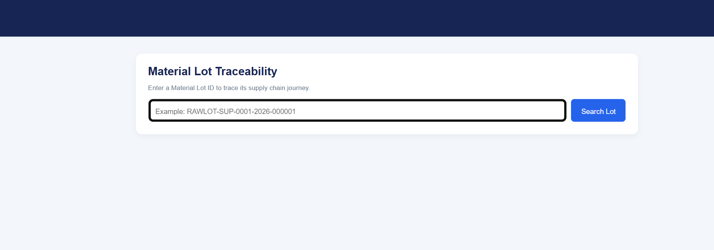
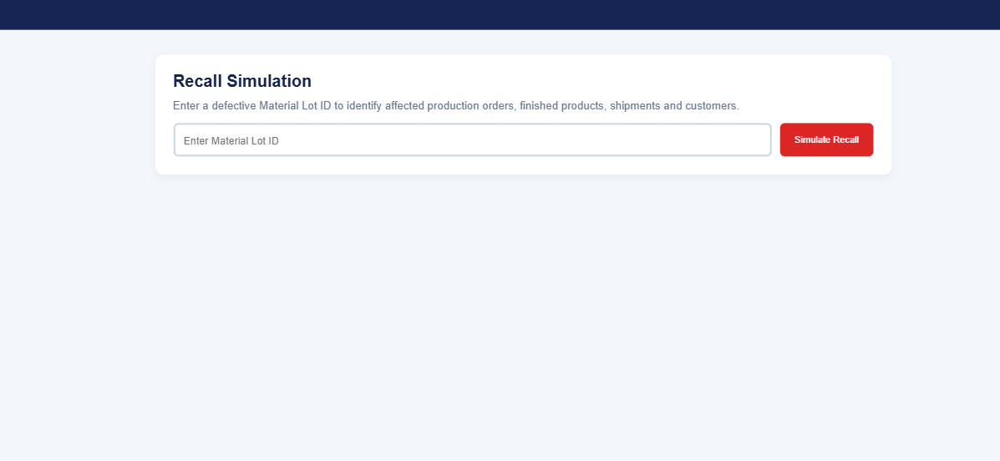
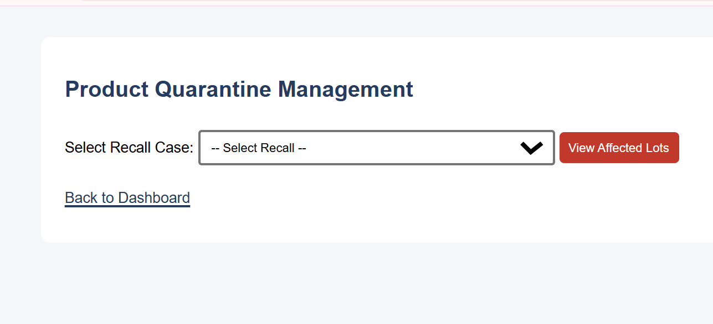
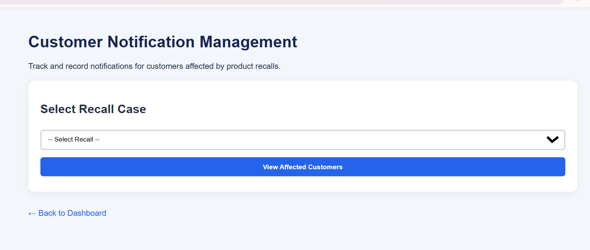
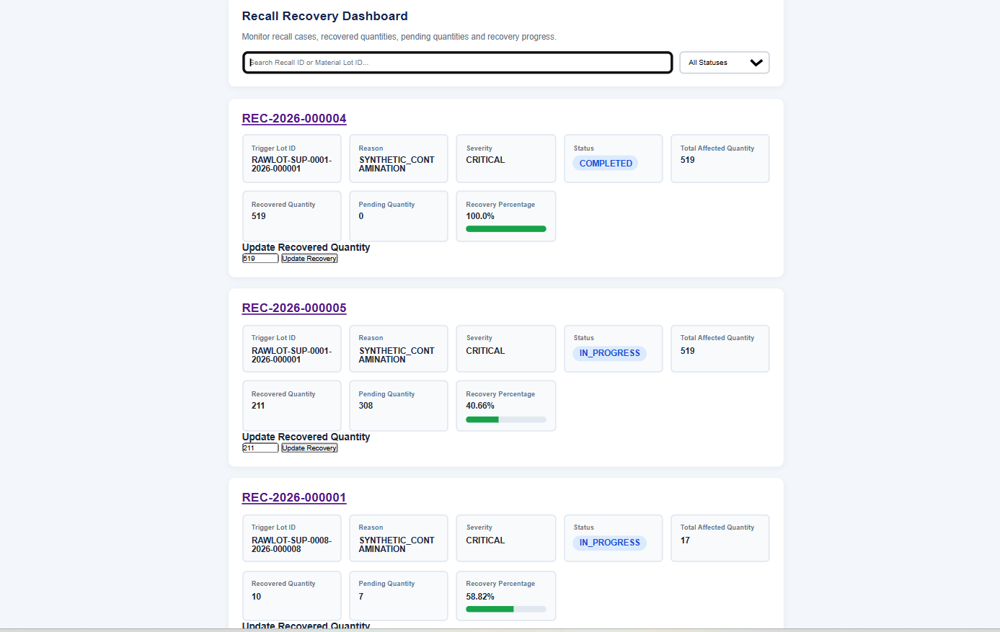

# TraceRecall – Supply Chain Traceability & Product Recall System

## Project Overview
TraceRecall is a Django-based web application developed to track products across the supply chain and manage product recalls efficiently.

The system helps identify affected raw materials, production lots, warehouses, shipments, and customers. It also supports recall simulation, product quarantine, customer notifications, and recovery tracking.

## Key Features
- **Supply Chain Traceability:** Track materials from suppliers to customers.
- **Recall Simulation:** Identify affected lots and calculate recall scope.
- **Recall Case Management:** Create and manage product recall cases.
- **Product Quarantine:** Quarantine affected products to prevent further distribution.
- **Customer Notifications:** Record customer notification activities.
- **Recovery Tracking:** Monitor recovered quantities and recall progress.
- **Dashboard Analytics:** View recall statistics and key information.
- **Exception Reports:** Generate reports for supply chain issues.
- **CSV Export:** Export relevant report data.

## Technologies Used
- **Backend:** Python, Django
- **Database:** MySQL
- **Frontend:** HTML, CSS, Django Templates
- **Data Processing:** Python, CSV
- **Tools:** VS Code, Git, GitHub

## Project Structure
```text
TraceRecall/
├── config/
├── traceability/
│   ├── migrations/
│   ├── templates/
│   ├── models.py
│   ├── views.py
│   ├── urls.py
│   └── tests.py
├── docs/
├── src/
├── output_full_2/
├── output_full_test/
├── manage.py
├── requirements.txt
└── README.md
```

## Installation and Setup

### 1. Clone the repository
```bash
git clone YOUR_GITHUB_REPOSITORY_URL
cd supply_chain_traceability_project
```

### 2. Create a virtual environment
```bash
python -m venv venv
```

### 3. Activate the virtual environment

Windows PowerShell:
```powershell
.\venv\Scripts\Activate.ps1
```

### 4. Install dependencies
```bash
pip install -r requirements.txt
```

### 5. Configure environment variables

Create a `.env` file in the project root using `.env.example` as a template.

Add your own Django secret key and MySQL database credentials. Never upload your actual `.env` file.

### 6. Create the MySQL database
```sql
CREATE DATABASE tracerecall_db;
```

### 7. Run migrations
```bash
python manage.py migrate
```

### 8. Start the development server
```bash
python manage.py runserver
```

Open in your browser:
`http://127.0.0.1:8000/`

## Testing
Run the Django test suite:
```bash
python manage.py test traceability
```

## Project Objective
To improve supply chain transparency and support faster, more accurate product recall management through end-to-end lot tracking and recall monitoring.

## Author
Nallabothula Venkata Bhagya Lakshmi

## Note
This project uses simulated supply chain data and records customer notification activities within the application. Actual SMS and email delivery is not configured.

## 📸 Application Screenshots

### 1. Supply Chain Traceability


### 2. Recall Simulation


### 3. Product Quarantine


### 4. Customer Notifications


### 5. Recall Action History

